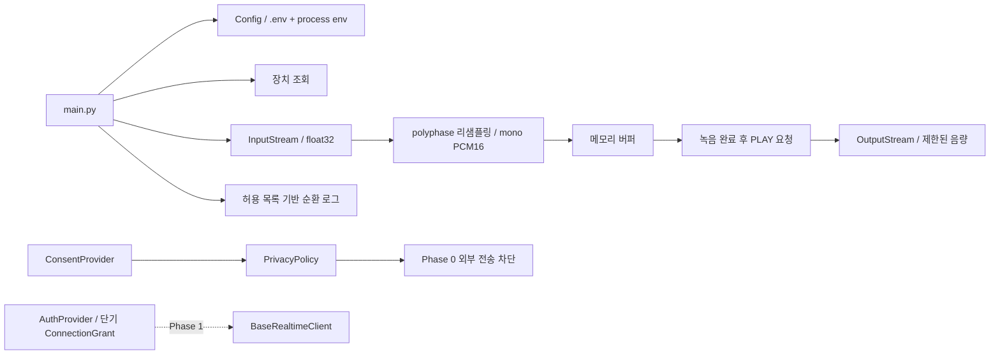

# Phase 0 아키텍처

> 2026-10-31 웹 전환: [최신 설계 및 검토 기준](../../docs/web_transition.md). 아래는 기존 Python/디바이스 기반 기록입니다. 제공자·개인정보 검토는 유지하고, Pi 장치 및 기기 인증 항목은 웹 기준으로 대체합니다.

`config.py`는 `.env`를 읽고 프로세스 환경값을 우선하며 타입/범위를 검증합니다. Phase 1 모델/인증 서버가 없더라도 오디오 진단을 실행합니다. 백엔드는 오디오 명령을 호출할 때만 로드합니다. 시스템 정보와 도움말은 PortAudio 없이 동작합니다.

녹음은 blocking InputStream에서 제한된 블록으로 읽습니다. 읽는 동안 피크/RMS 누적과 클리핑을 측정하며 오버플로는 성공한 녹음으로 취급하지 않습니다. 선택한 장치의 지원 주파수를 검사하고 SciPy `resample_poly`로 필터링/리샘플링합니다. 여러 입력 채널은 평균으로 모노 변환한 뒤 signed PCM16으로 변환합니다. -1 → -32768, +1 → +32767, 범위 초과는 제한합니다. 저장/업로드 호출은 없습니다.

출력도 지원 주파수를 검사합니다. PCM16은 float32로 변환하고 디지털 음량을 제한합니다. 동기식 재생 중 다른 스레드에서 `Speaker.stop()`을 호출하면 다음 블록 전에 중단합니다. CLI는 Ctrl+C로 중단합니다. 모든 스트림은 context manager로 종료하고, `finally`로 소유한 배열을 정리합니다. 녹음과 재생은 동시에 열리지 않습니다.

`BaseRealtimeClient`는 connect/disconnect/send_audio/receive_events/cancel_response/get_connection_state 계약만 선언합니다. `AuthProvider`는 acquire/refresh/revoke 계약입니다. `ConnectionGrant`는 timezone-aware 만료 시각과 30초 안전 여유를 검사하고 토큰을 repr에서 숨깁니다. 실제 인증이나 만료 시 자동 갱신은 구현하지 않습니다.

`ConsentProvider`는 미래의 검증된 동의 시스템용 계약입니다. 로컬 미검증 구현은 동의를 승인할 수 없습니다. `PrivacyPolicy`는 저장 플래그 + 현재 동의 상태를 검사하며 외부 전송은 항상 차단합니다. 개발 CLI의 임시 로컬 진단은 성인/합성 음원용이며 보호자 검증을 완료한 제품 흐름으로 간주하지 않습니다.

삭제 함수는 호출자가 지정하는 **앱 전용 user_data 디렉터리**에만 사용해야 합니다. 알려진 데이터 확장자만 허용하고 심볼릭 링크/중첩 디렉터리/알 수 없는 파일은 거부합니다. 기본 동작에서는 이 디렉터리를 만들지 않습니다. 삭제는 파일 제거이며 포렌식 수준의 물리 삭제가 아닙니다. SQLite 스키마나 서버 데이터는 Phase 4 이후 별도 삭제 어댑터가 필요합니다.

Windows/Pi 차이는 PortAudio와 OS 장치 권한으로 격리합니다. 특정 호스트 API나 고정 장치 ID를 하드코딩하지 않습니다. 클라우드 설치 스크립트의 Debian amd64 경로는 개발 인프라용이며 앱 코드의 플랫폼 종속성은 아닙니다.
