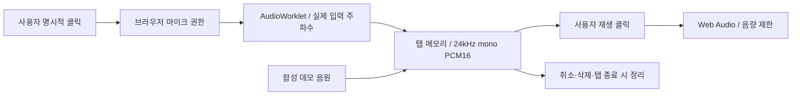

# 물리 디바이스 → 웹 전환 계획과 구현

갱신일: 2026-10-31. 사용자가 실제 기기를 제작하지 않기로 했으므로 **주 개발 경로를 웹 브라우저**로 변경했습니다. 기존 Python 구현은 보존하며 웹 실행의 필수 요소에서는 제외합니다.

## 이번에 구현한 범위

| 기존 요소 | 웹에서의 대안 | 구현 상태 |
|---|---|---|
| Pi/Windows Python 실행 | TypeScript + Vite 정적 웹 | 구현 |
| PortAudio 장치 조회 | 명시적 권한 요청 후 MediaDevices | 구현 |
| 마이크 수집 | getUserMedia + AudioWorklet, 최대 5초 | 구현 |
| 모노 PCM16/24kHz | OfflineAudioContext 리샘플링 + PCM16 변환 | 구현 |
| 스피커 출력/중단 | Web Audio, 제한된 신호 진폭, 즉시 취소 | 구현 |
| 실물 장치 없는 체험 | 브라우저 내 합성 음원 | 구현; AI 응답 아님 |
| 로컬 음성 파일 | 탭 메모리의 임시 버퍼만 | 기본 저장 없음 |
| 기기 점검 기록 | 대시보드의 오디오 상태와 수동 청취 | 별도 체크리스트 페이지 제거 |
| 보호자 동의/AI 인증 | 서버 기반 보호자 계정·세션·중계 | Phase 1 전 설계/확인 필요 |

화면은 대시보드와 오디오 테스트입니다. 개인정보와 체크리스트 메뉴·페이지·연결 카드는 제거하고, 개인정보 처리는 체험 로그인 팝업의 명시적 동의로 안내합니다. 미동의 상태에서는 마이크 요청을 하지 않으며 합성 데모만 사용할 수 있습니다. 음성은 외부로 전송하지 않고, 수동 재생만 제공합니다. 탭 비활성화/페이지 종료 시 임시 오디오를 정리합니다. 데이터베이스나 실제 AI 응답 기능을 새로 구현하지 않았습니다.

## 현재 데이터 흐름



정적 웹 호스팅은 앱 파일을 전송할 뿐 음성을 받지 않습니다. 호스팅의 접속 로그에는 IP 등이 남을 수 있으므로 실제 배포 전 확인합니다. 브라우저 장치 권한과 보호자 개인정보 동의는 별개의 절차입니다.

## Phase 1 전 검토도 웹 기준으로 변경

| 이전 검토 | 웹에서 확인할 것 | 구체적인 방법 / 통과 기준 |
|---|---|---|
| Pi 5 오디오/전원/드라이버 | 대상 PC/휴대폰·브라우저·HTTPS | Chrome/Edge와 실제 사용할 Safari/Firefox, 모바일에서 권한 허용/거부, 5초 녹음, 직접 청취, 기기 분리/앱 전환/재시도 확인 |
| DEVICE_ID + 기기 자격증명 | 보호자 계정과 안전한 서버 세션 | 서버 로그인, HttpOnly/Secure 쿠키 등 세션 관리, 만료/로그아웃/접근 제어; 임의 브라우저 ID를 인증으로 취급하지 않음 |
| 기기 내 토큰 저장 | 브라우저에 비밀을 남기지 않는 구조 | 장기 제공자 키는 서버에만 보관; localStorage/URL/번들/로그에 키·권한을 남기지 않는지 검사 |
| 기기↔제공자 연결 | 브라우저↔인증/중계 서버↔제공자 | 서버가 세션/동의/Origin/사용량을 검사하고 음성 전달; HTTPS/WSS, 허용 Origin, 쿠키 사용 시 CSRF/교차 사이트 연결 보호 확인 |
| 기기 권한 철회 | 보호자 동의 철회·서버 세션 종료 | 전송 큐 제거, 응답/로컬 재생 취소, 서버 연결 종료, 만료/철회 후 재연결 차단 |
| Pi 장치 삭제 | 탭·서버·백업 데이터 삭제 | 세션 종료 후 브라우저 녹음 복구 안 됨; 향후 서버가 생기면 사용자별 접근/삭제 어댑터 추가 |
| 펌웨어 배포 | HTTPS 웹 배포 | 정적 빌드, CSP/Permissions-Policy, 오디오 경로/MIME 확인; API 키가 빌드에 없는지 검토 |

쿠키/서버 세션은 Phase 1 제안이며 현재 앱에는 실제 계정 로그인이나 쿠키가 없습니다. 체험 로그인은 이 탭의 로컬 동의 흐름이며 계정 인증/법정대리인 확인을 대신하지 않습니다. 브라우저 ID/핀 번호/체크박스로 보호자나 법정대리인 확인이 완료됐다고 처리하지 않습니다. 실제 계정/동의 방식은 법적·제공자 검토에 맞춰 구현해야 합니다.

## 다음 단계의 권장 구성

```text
웹 UI ── HTTPS/WSS, 보호자 세션 ──> Python 인증·중계 서버 ──> Realtime API
                                       │
                                       ├─ 검증된 보호자 동의/철회
                                       ├─ 세션 권한·Origin·접근 제어
                                       └─ 비용 상한·취소·음성 기본 저장 금지
```

1. 보호자 관리 채널과 서버 세션을 설계하고 mock 서버로 인증/동의/취소 시험을 먼저 수행합니다.
2. 제공자의 만 3~6세 이용 조건과 음성 보관/국외 이전 등 국내 적용 요건을 확인합니다. 최신 조건이 충족됐다고 아직 검증하지 않았습니다.
3. 요건을 확인한 개발 환경에서 성인/합성 음원으로 제한해 실제 제공자 어댑터를 구현합니다. 서버 장기 키를 `VITE_*` 설정에 넣으면 공개 번들에 포함되므로 금지합니다.
4. 401/403/429, 만료, 철회, 늦은 응답, 네트워크 단절, 앱 전환, 오디오 출력 취소와 비용 상한을 시험합니다.
5. 실제 아동 데이터 전송과 아동 대상 시험은 필요한 검토·동의·운영 조건이 확인된 이후 별도로 활성화합니다.

현재 모모는 Phase 0입니다. 기존 `ai_friend/docs/phase1_readiness_review.md`의 제공자/법적/동의 검토는 계속 적용하지만, Pi 하드웨어와 기기 키 기반 인증 항목은 웹의 계정/브라우저/서버 검토로 대체합니다. 에코 제거/VAD/책 읽기/감정 분석/장기 기억은 이번 웹 전환에 포함하지 않습니다.

## 검증 기록

- TypeScript 검사 및 정적 배포 빌드 통과.
- Chromium 데스크톱/모바일 설정 46개 테스트 통과 (가상 마이크 사용).
- 5초/24kHz/120,000 프레임, 명시적 재생, 출력 진폭 제한, 무음 루프백, 취소/지연 응답/버퍼 정리 경로 구현 및 시험.
- 데모 사용 시 마이크 요청 0건, 업로드/외부 도메인 요청 0건, 브라우저 저장소 미사용 확인.
- 가상 장치 검증은 실제 PC/휴대폰 마이크 품질과 청취 검증을 대신하지 않음.
- 공개 호스팅 배포와 실제 Safari/iOS/Firefox 시험은 미실행.

웹 개발에는 Python/PortAudio 설치가 필요하지 않습니다. `scripts/setup_cloud.sh`는 웹 설치/빌드/검증을 수행합니다. 기존 Python 설치는 `scripts/setup_python.sh`로 보존했습니다.
